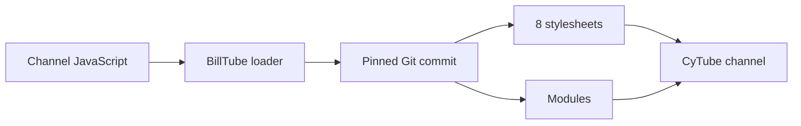

<div align="center">

# BillTube 3

### Version 3 for CyTube channels

BillTube adds player controls, chat tools, movie information, mobile layouts, and a settings panel. It is installed through Channel JavaScript.

<p>
  
  
  
  
</p>

[Install](#installation) · [Features](#features) · [Settings](#channel-theme-toolkit) · [Help](#help-and-feedback)

</div>

---

## About

BillTube is a theme for [CyTube](https://github.com/calzoneman/sync). It changes the channel layout and adds optional tools for video playback, chat, movie information, and channel administration.

It runs from Channel JavaScript, so it does not need a separate website or server. Most settings can be changed from the Channel Theme Toolkit after installation.

## How it loads

The loader resolves the `main` branch to a Git commit before loading BillTube. This keeps the framework, its modules, and its 8 stylesheets on the same revision. If jsDelivr fails, the loader tries a second CDN.



## Features

### Player

- Theater mode, picture-in-picture, fullscreen controls, and Chromecast support
- Audio enhancement with a 2.5× volume boost and dynamic-range compression presets for loudness normalization
- Automatic English subtitle fetching for direct video files through Wyzie or SubDL, with a Stremio addon fallback
- Local subtitle file loading
- Full-width video and touch controls on phones and tablets
- Event countdowns shown in each viewer's local time

### Chat

- Emote picker with channel emotes, animated emoji, recent emotes, and searchable community packs
- Inline emote autocomplete with image previews
- GIF search and favorites
- Scrolling up pauses chat follow for 25 seconds after the last upward input; the next message then resumes it. Manually returning to the bottom or clicking **New Messages Below** resumes immediately.
- GIFs and emotes outside a 600 px buffer around the chat viewport are suspended with their layout space preserved, and restored before scrolling into view
- Avatars, timestamps, mentions, and notification sounds
- Spoilers, text styling, chat colors, ignore controls, and a user-list overlay
- Emote packs from 7TV, BetterTTV, FrankerFaceZ, and emoji.gg

### Movie features

- Now-playing cards with posters, summaries, and ratings
- Movie polls with TMDB information
- Movie poll winners appear in a toast for everyone connected to the channel, including viewers without poll permissions or with auto polls turned off. Public vote counts determine the winner; ties and no-vote polls use a shared tiebreak seeded by the server poll timestamp and options, so every client names the same movie. Only the originating client queues the winner.
- Random Movie Poll and Auto credits polls share a settings dialog. Manual polls show candidates and reroll; auto polls save their enabled state, movie count (2–10), voting time (30–900 seconds), Bustin mode, and Balanced picks per channel in this browser. Bustin mode queues the playlist video titled **Bustin** when the poll opens, then checks its position again so it plays immediately before the winner. Bustin is excluded from nominations; missing Bustin falls back to normal winner placement.
- Auto credits polls default **on** for viewers with poll-control and playlist-move permissions. A saved on/off choice and other saved settings always take precedence; viewers can opt out in the settings dialog. Polls run entirely in eligible viewers' browsers. Each client waits a random **0–10 seconds**, listens for CyTube's poll broadcasts, and rechecks playback, connection, permissions, and existing polls before sending. The trigger includes the delay budget and preserves a 30-second queue buffer; late polls shorten voting. This reduces collisions across viewers without a bot, server, or shared movie history; requests within the broadcast's network delay can still race. Launches time out if unconfirmed, and replacement polls cancel stale winner actions. The originating tab saves its active poll in session storage so a refresh or reconnect can resume it only when the server still reports the matching poll. A poll that finishes while the tab is offline cannot be completed retrospectively.
- Selection covers every loaded entry below the current movie, with no proximity window or candidate limit. Earlier entries, current media, previous locally recorded winners, the last 50 distinct locally observed played movies, and duplicate entries are excluded. Incomplete playlists show a loading message. Polls aim for up to four distinct decades, but fresh choices take precedence over repeating a scarce decade. Unknown-year movies receive proportional wildcard space, including in smaller polls. Choices from the last **three actual movie polls** are avoided when alternatives exist, then become eligible again. Rerolls avoid up to 20 previews only while that builder is open; previews do not advance the actual-poll cooldown. **Movie history** remains local and clearable.
- Optional **Balanced picks** mildly favors established ratings, varied genres and franchises, and feature-length movies when information is available; wildcard choices stay random. It reuses details already fetched for movie posters, with a bounded browser-local cache and no extra lookups at poll launch. Release metadata takes precedence over title guesses; numeric titles such as **1917** and **Blade Runner 2049** are not mistaken for release years. Tagged and attached release years such as `Alien1979` remain supported. Missing metadata always falls back to ordinary random selection.
- **Poll suggestions** feed Random Movie Poll and Auto credits polls. Enable the existing Random Movie Poll integration, then an admin can check **Theme → Playlist Catalogue → Enable poll suggestions** and click **Apply**. The setting is saved with the existing channel configuration in Channel JS and broadcast by CyTube to connected viewers, so it survives reloads and applies to new arrivals. Suggestion styling lives in the theme CSS files. Signed-in registered users can click **Suggest for poll** on a movie to post a title/year command in chat; guests cannot nominate. Each username can have one pending suggestion or one served suggestion in the current round. Duplicate movies, malformed commands, muted/shadowed senders, rapid clicks, and oversized queues are rejected.
- Both existing poll modes prioritize up to **six** matching suggestions, then fill remaining slots with their usual random picks. Six suggestions can expand a smaller configured poll to six options; total options still cap at ten. Overflow stays queued in arrival order and cannot accidentally enter the same poll as a random pick. Title/year matching ignores spacing, punctuation and accents, accepts attached years and extra labels (such as Extended Edition or trailing resolution metadata), and requires the same release year. Exact titles take priority; ambiguous alternatives, partial-word lookalikes and added sequel numbers are not substituted. Winner queuing uses the exact matched playlist title and UID. Suggestions search the entire playlist, above and below the current movie, regardless of local played/winner history. The currently playing movie and Bustin are excluded. Random filler retains its existing upcoming-only and history rules. Unavailable or ambiguous matches remain pending for moderator review.
- Playlist text search also ignores spacing, punctuation and accents while retaining its existing type, user, duration and temporary-item filters. Suggestion matching reuses a cached playlist index, invalidated by playlist/current-movie changes and revalidated before launching a poll. An unchanged suggestions list is not rebuilt on its control timer; title caches are bounded and playlist filtering retains its input debounce.
- Eligible moderators have a lightbulb button with a suggestion count beside the poll controls. Its dialog shows movie titles, usernames and compact status badges. The trash icon clears pending suggestions **only in the current browser**, persists that local clear across refreshes, and prevents older chat messages from restoring them. It sends no chat command and leaves other moderators' lists unchanged; legacy shared clear commands are ignored. Only confirmed movie polls consume included entries; cancelled previews and rejected launches preserve them. Poll closure or movie changes release served usernames while retaining pending overflow. Queues are browser-local per channel and survive refreshes; connected clients independently observe the same server chat and poll events. A client that was offline or joined later cannot recover events missing from both its saved state and CyTube's short chat buffer; this is a browser feature, without an always-on server or bot. Keep an eligible moderator connected while collecting nominations.
- A searchable playlist catalogue with decade and minimum TMDB rating filters (2+, 4+, 6+ or 8+ out of 10). Filters combine with search and sorting across the full list; a centered moving loading indicator respects reduced-motion settings.
- End-of-movie audience ratings and a channel leaderboard
- Movie cards posted by the `!summary` chat command

### Appearance and channel settings

- Color presets and individual color settings
- Typography presets, custom fonts, branding, favicons, and poster overrides
- Patterned backgrounds with previews
- Featured content, custom resources, and optional channel modules
- Configuration backup and restore

## Installation

You need administrator access (rank 3 or higher) on the CyTube channel.

1. Open **Channel Settings → Edit → Channel JavaScript**.
2. Paste the loader below into the editor.
3. Save your changes and reload the channel.
4. Open the new **Theme** section in Channel Settings to configure BillTube.

```js
/* BillTube 3 loader */
(function (window, document) {
  var repository = "BillTube/BillTube3";
  var branch = "main";
  var entrypoint = "billtube-fw.js";

  if (window.BTFW || document.querySelector("script[data-btfw-loader]")) return;

  function inject(source, onError) {
    var script = document.createElement("script");
    script.src = source;
    script.async = false;
    script.dataset.btfwLoader = "1";
    if (onError) script.onerror = onError;
    document.head.appendChild(script);
  }

  function loadFallback() {
    inject(
      "https://rawcdn.githack.com/" + repository + "/" + branch + "/" + entrypoint + "?t=" + Date.now()
    );
  }

  fetch("https://api.github.com/repos/" + repository + "/branches/" + branch, { cache: "no-store" })
    .then(function (response) {
      if (!response.ok) throw new Error("Unable to resolve the current release");
      return response.json();
    })
    .then(function (release) {
      var version = release.commit.sha;
      inject(
        "https://cdn.jsdelivr.net/gh/" + repository + "@" + version + "/" + entrypoint,
        loadFallback
      );
    })
    .catch(function () {
      inject(
        "https://cdn.jsdelivr.net/gh/" + repository + "@" + branch + "/" + entrypoint,
        loadFallback
      );
    });
})(window, document);
```

BillTube checks for updates when the channel loads. The loader does not need to be replaced for each release.

### Chat filters

The Theme Toolkit shows the status of BillTube's chat filters at the top of the dashboard. If an update is available:

1. Open **Theme → Chat Filters**.
2. Select **Import Required BillTube Chat Filters**.
3. Confirm with CyTube's **Import filter list** action.

These filters handle spoilers, text styling, emote-pack tokens, and movie cards in chat.

## Channel Theme Toolkit

The Theme Toolkit is available under **Channel Settings → Theme**. Administrators can change BillTube settings there and preview appearance changes before applying them.

| Section | What you can manage |
| --- | --- |
| **Appearance** | Color presets, individual colors, patterned backgrounds, typography, and branding |
| **Featured content** | Featured channels, additional resources, and optional modules |
| **Event countdown** | A channel-wide event title and start time, localized for every viewer |
| **Integrations** | Movie data, GIF search, subtitles, audio enhancement, and audience ratings |
| **Playlist catalogue** | A public movie list built from the channel playlist |
| **Emote marketplace** | Community emote packs from supported providers |
| **Backup & restore** | Export or import BillTube settings as JSON |

The toolkit updates BillTube's marked configuration blocks. It leaves other Channel JavaScript and Channel CSS in place.

## Optional integrations

Most of BillTube works without an external service. These features need additional configuration:

| Feature | Optional service |
| --- | --- |
| Movie information, polls, catalogue, and summaries | [TMDB API key](https://www.themoviedb.org/settings/api) |
| GIF search | Klipy API key |
| Automatic subtitle fetching | A TMDB API key; Wyzie and SubDL keys are optional because a Stremio addon fallback is included |
| Audience ratings | A compatible ratings endpoint |
| Private Drive library search | The BillTube Drive Worker bridge and a per-browser access token |

> [!IMPORTANT]
> Integration keys saved through the toolkit are stored in the channel's public JavaScript and can be viewed by visitors. Use restricted or free-tier keys that are safe to expose. Never enter a private or privileged credential.

The Drive library access token is an exception: it is entered from **Add media → Drive library → Connection** and stored only in that browser's local storage. It is not written to Channel JavaScript. The matching `BTFW_LIBRARY_TOKEN` must be configured as a secret on the Drive Worker.

## Chat commands

| Command | Purpose |
| --- | --- |
| `!help` | Show the commands available to you |
| `!now` | Show information about the current video |
| `!summary [title]` | Post a movie summary card |
| `!time` | Show the current channel time |
| `!dice` / `!roll` | Roll the dice |
| `!pick a,b,c` | Pick one item from a list |
| `!ask <question>` | Ask a randomized yes-or-no question |
| `!sm` | Post a random channel emote |
| `!leaderboard` | Show the trivia leaderboard |

Moderators also have access to playlist and playback commands such as `!skip`, `!next`, `!bump`, and `!add <url>` according to their CyTube rank.

## Requirements

- A CyTube channel with administrator access for installation
- A current version of Chrome, Edge, Firefox, or Safari
- JavaScript enabled in the browser

BillTube does not require an account, database, or dedicated server. Optional integrations connect directly to their configured services.

## Help and feedback

To report a problem or suggest a change, [open an issue](https://github.com/BillTube/BillTube3/issues). Include your browser and, when useful, a screenshot or console error.

## Credits

- Background patterns by [Hero Patterns](https://heropatterns.com/) (Steve Schoger, CC BY 4.0)
- Animated emoji by [Noto Emoji](https://googlefonts.github.io/noto-emoji-animation/) (Google, Apache-2.0)
- Icons by [Font Awesome](https://fontawesome.com/)
- Player components by [video.js](https://videojs.com/)
- Motion powered by [anime.js](https://animejs.com/)
- Community emotes from [7TV](https://7tv.app/), [BetterTTV](https://betterttv.com/), [FrankerFaceZ](https://www.frankerfacez.com/), and [emoji.gg](https://emoji.gg/)
- Movie data from [TMDB](https://www.themoviedb.org/)

BillTube uses the TMDB API but is not endorsed or certified by TMDB.

---

<div align="center">

BillTube 3 is the successor to [BillTube 2](https://github.com/BillTube/BillTube2).

</div>
